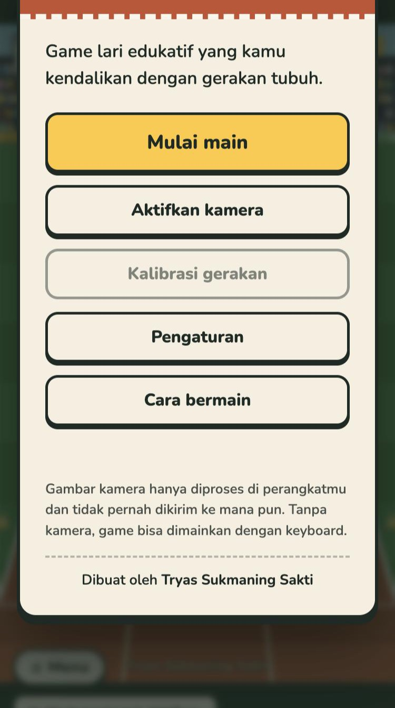
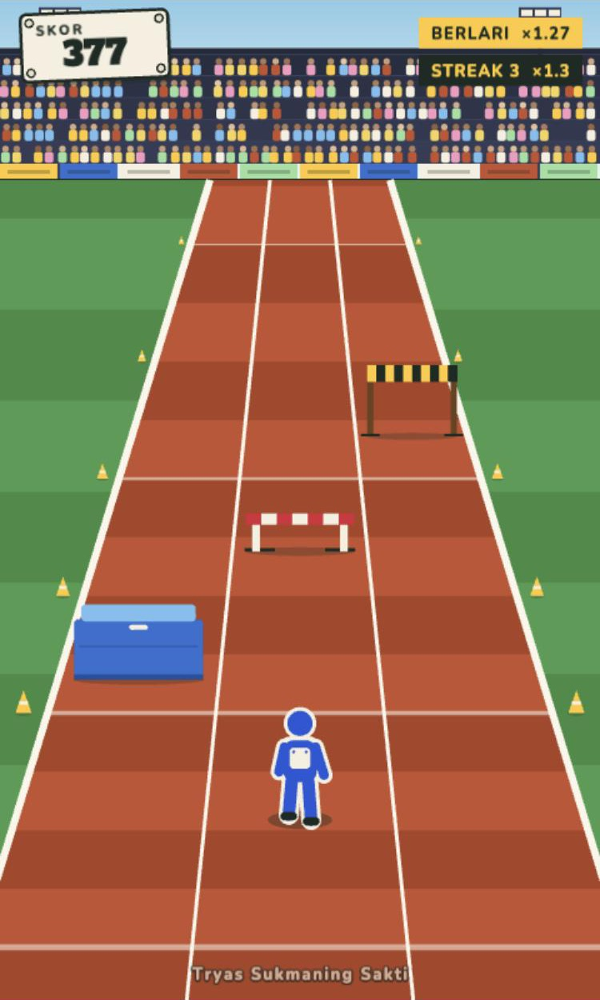
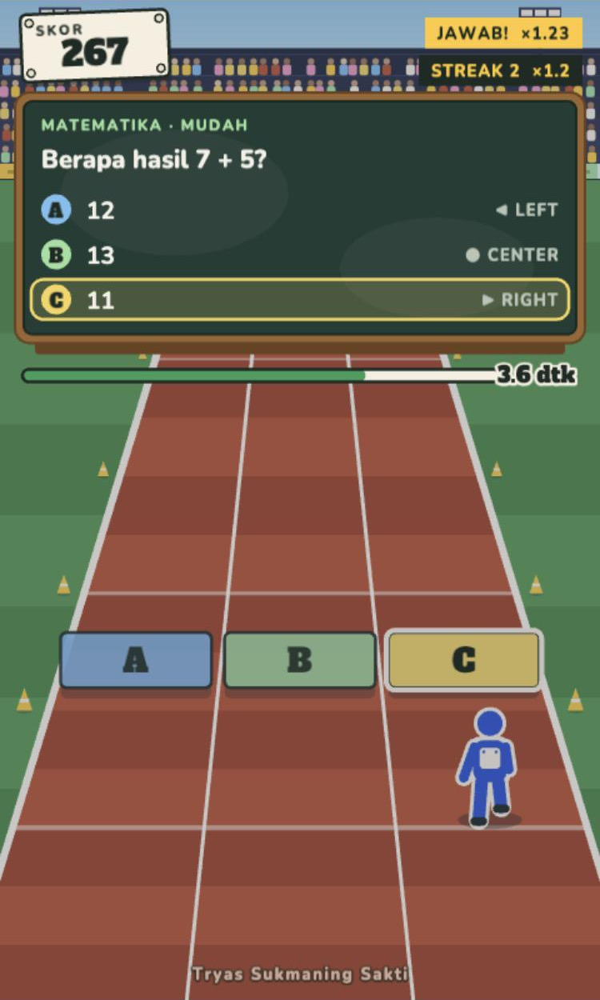
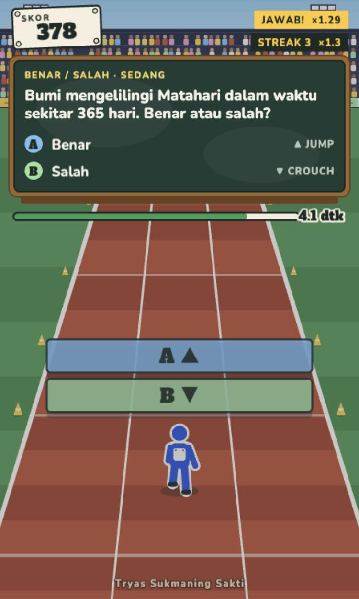
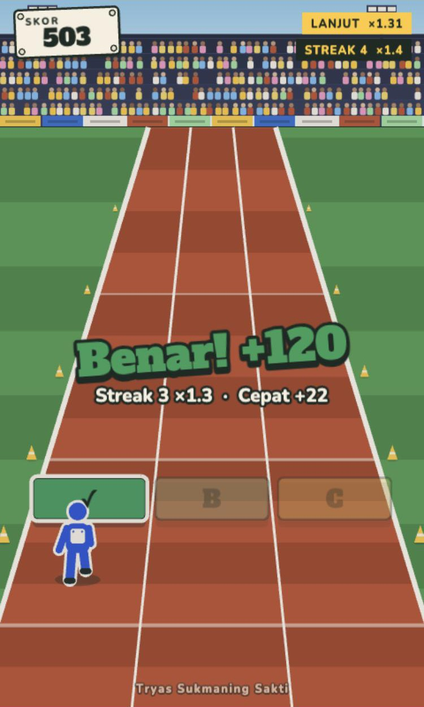
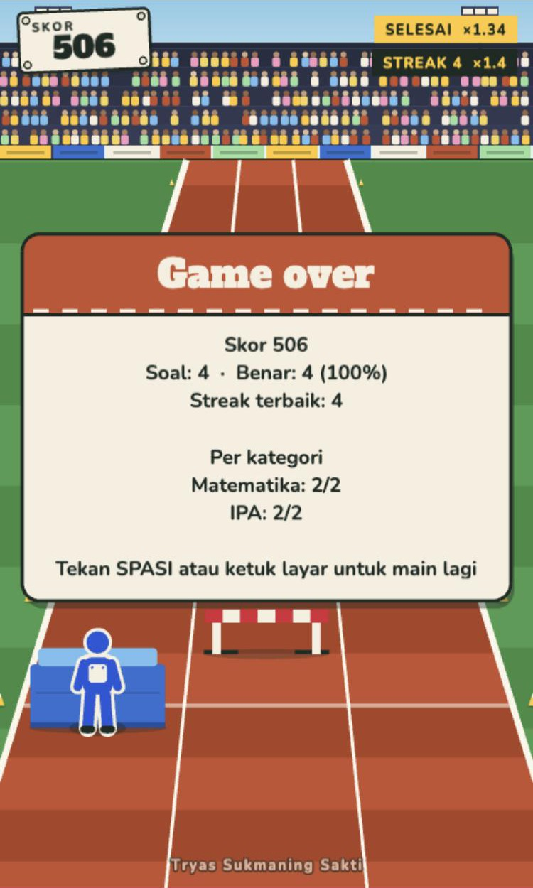

# Motion Runner

Dibuat oleh **Tryas Sukmaning Sakti**.

Game lari edukatif yang dikendalikan gerakan tubuh lewat webcam. Karakter berlari terus, dan sebelum
rintangan tertentu permainan melambat dan menampilkan soal. Soal dijawab dengan berpindah lajur,
melompat, atau jongkok. Semuanya berjalan di browser (TypeScript, MediaPipe Pose, Phaser), tanpa Python.

## Pratinjau

<table>
  <tr>
    <td align="center" valign="top"><br><sub><b>Menu utama</b><br>kamera, kalibrasi, pengaturan</sub></td>
    <td align="center" valign="top"><br><sub><b>Berlari</b><br>matras, gawang, dan palang atas</sub></td>
    <td align="center" valign="top"><br><sub><b>Soal pilihan ganda</b><br>berdiri di lajur jawabannya</sub></td>
  </tr>
  <tr>
    <td align="center" valign="top"><br><sub><b>Benar atau salah</b><br>lompat untuk atas, jongkok untuk bawah</sub></td>
    <td align="center" valign="top"><br><sub><b>Hasil jawaban</b><br>poin, pengali beruntun, bonus cepat</sub></td>
    <td align="center" valign="top"><br><sub><b>Ringkasan</b><br>skor dan hasil per kategori</sub></td>
  </tr>
</table>

## Menjalankan

Butuh Node.js. Dari folder proyek:

```bash
npm install
npm run dev
```

Lalu buka alamat yang ditampilkan (biasanya <http://localhost:5173>) di **Chrome**. Alamat utama adalah gamenya.

| Halaman | Isi |
| --- | --- |
| `/` | Game |
| `/movement.html` | Halaman uji deteksi gerakan (landmark, ambang, FPS) untuk menyetel deteksi |

Kamera hanya boleh dipakai di `localhost` atau HTTPS. Gambar kamera diproses di perangkatmu saja dan
tidak pernah dikirim ke mana pun.

## Cara bermain

Tanpa kamera, game bisa dimainkan dengan keyboard:

| Tombol | Aksi |
| --- | --- |
| ← → | Pindah lajur |
| ↑ | Lompat |
| ↓ | Jongkok |
| Spasi | Mulai / main lagi |
| P | Jeda |
| Esc atau M | Menu |

Dengan kamera: buka **Menu → Aktifkan kamera**, berdiri sampai seluruh badan terlihat, lalu
**Kalibrasi gerakan** (berdiri, geser kiri, geser kanan, lompat, jongkok). Hasil kalibrasi disimpan di
browser dan menyesuaikan ambang deteksi dengan tinggi badan dan jarakmu. Untuk mulai, lompat di depan
kamera. Kalau kamu keluar dari kamera saat bermain, game berhenti sendiri dan lanjut saat kamu kembali.

Di bawah gambar kamera ada **meter gerakan**: posisimu terhadap batas lajur, seberapa tinggi pinggulmu naik
(lompat), dan seberapa turun (jongkok). Garis hitam di tiap meter adalah batas yang harus dilewati supaya gerakan
terhitung. Kalau gerakanmu berhenti sebelum garis, naikkan sensitivitas atau kalibrasi ulang.

Saat ada soal, dunia melambat. Soal pilihan ganda dijawab dengan berdiri di lajur jawabannya (A kiri,
B tengah, C kanan). Soal gerakan dijawab dengan melompat atau jongkok.

## Ponsel dan tablet

Tata letak menyesuaikan ukuran layar (`src/app/layout.ts`), supaya gambar kamera dan meter tidak menutupi game:

| Layar | Tata letak |
| --- | --- |
| Desktop, tablet mendatar, ponsel mendatar | Panel kamera di samping kolom game |
| Tablet tegak | Kolom khusus di kiri untuk panel kamera, game memakai sisanya |
| Ponsel tegak | Tombol **Menu** di bilah atas, panel kamera menjadi bilah di bawah game, dengan gambar kamera kecil |

Layar sentuh tidak punya keyboard, jadi di ponsel dan tablet muncul **tombol sentuh** di atas game: ◀ ▶ untuk pindah lajur,
Lompat, dan Jongkok. **Ketuk layar** (atau tombol apa saja) untuk mulai atau main lagi. Bermain dengan kamera depan
tetap berjalan seperti biasa.

## Pengaturan

Menu → **Pengaturan** (disimpan di browser):

- kategori soal, tingkat kesulitan (bertahap atau tetap), dan kecepatan lari
- **waktu soal**: waktu baca soal, batas waktu menjawab, dan kunci jawaban otomatis (setelah berapa detik
  diam jawabanmu dikunci; matikan kalau mau selalu menunggu waktu habis)
- **sensitivitas gerakan**: naikkan kalau lompat, jongkok, atau pindah lajur sering tidak terdeteksi
- ukuran gambar kamera, suara dan volume, kontras tinggi, kurangi animasi, dan pratinjau kamera

Bisa juga lewat alamat, misalnya `/?categories=math,science&difficulty=hard`
(`difficulty`: `easy`, `medium`, `hard`, atau `progressive`).

## Tampilan

Temanya hari olahraga sekolah: lintasan lari tartan, papan tulis kapur untuk soal, nomor dada untuk skor,
dan menu seperti kertas program pertandingan. Huruf (Alfa Slab One dan Nunito) dimuat dari Google Fonts;
tanpa internet game tetap jalan dengan huruf bawaan sistem.

Semua warna ada sebagai token `--c-*` di bagian atas `src/app/app.css`. Kanvas game membaca token yang
sama saat dimulai (`src/ui/theme.ts`), jadi mengubah satu warna di sana mengubah menu dan lintasan sekaligus.
Gambar dunia ada di `src/game/render/` (latar tribun, lintasan, rintangan, tokoh pelari).

## Menambah soal

Soal disimpan sebagai file JSON di folder `public/questions/`, satu file per kategori, dan dibaca saat
game dimuat. Jadi untuk menambah atau mengubah soal, cukup sunting file lalu refresh halaman. Tidak perlu build ulang.

Soal bawaan berisi materi kelas VII Kurikulum Merdeka: `ips.json` (IPS), `science.json` (IPA), `math.json` (Matematika),
dan `language.json` (Bahasa Indonesia). Tiap mapel punya soal mudah, sedang, dan sulit, serta beberapa soal benar/salah
(lompat untuk benar, jongkok untuk salah).

- `index.json` memuat daftar file yang dipakai: `{ "files": ["math.json", "science.json"] }`
- Nama file menjadi nama kategori (`math.json` → kategori `math`), kecuali soalnya menulis `category` sendiri.
- Untuk kategori baru: buat file baru, daftarkan di `index.json`, dan beri nama tampilannya di
  `questions.categoryLabels` pada `src/config/gameConfig.ts`.

Contoh soal pilihan ganda (dijawab dengan berdiri di lajur): jawaban pertama ke lajur kiri, kedua ke tengah,
ketiga ke kanan. Urutannya diacak tiap kali soal muncul.

```json
{
  "id": "math-7-plus-5",
  "text": "Berapa hasil 7 + 5?",
  "type": "LANE",
  "difficulty": "EASY",
  "answers": [{ "text": "12", "correct": true }, { "text": "11" }, { "text": "13" }]
}
```

Soal gerakan (`"type": "MOVEMENT"`) menulis `action` di tiap jawaban: `JUMP` (lompat, tampil di atas) atau
`CROUCH` (jongkok, tampil di bawah). `difficulty` adalah `EASY`, `MEDIUM`, atau `HARD`, dan tiap soal harus punya
tepat satu jawaban `correct`.

Tiap file diperiksa sendiri-sendiri. File yang salah ditulis dilewati dan semua kesalahannya dilaporkan di
konsol browser (F12) dan di menu, sementara file lain tetap dimuat.

## Pengembangan

```bash
npm test         # unit test (Vitest)
npm run typecheck
npm run build
```

Semua nilai yang bisa disetel (ambang gerakan, kecepatan, waktu slow motion, skor, kalibrasi) ada di
`src/config/gameConfig.ts`. Struktur kode:

- `src/camera`, `src/pose`: webcam dan estimasi pose (MediaPipe)
- `src/movement`: deteksi lajur, lompat, jongkok (terpisah dari game)
- `src/input`: `MotionInput`, gabungan kamera, pose, dan deteksi gerakan
- `src/game`: aturan game (`GameManager`), pemilihan soal, skor, adegan Phaser
- `src/questions`: model soal, pemetaan jawaban, validasi
- `src/settings`: pengaturan pemain dan kalibrasi
- `src/audio`, `src/ui`, `src/app`: suara, antarmuka, dan perakit aplikasi

## Lisensi

[MIT](LICENSE) © 2026 Tryas Sukmaning Sakti.

Dibangun dengan pustaka pihak ketiga yang punya lisensinya sendiri: [Phaser](https://phaser.io) (MIT),
[MediaPipe Tasks Vision](https://developers.google.com/mediapipe) (Apache-2.0), dan huruf Alfa Slab One dan Nunito
(SIL Open Font License) yang dimuat dari Google Fonts.
